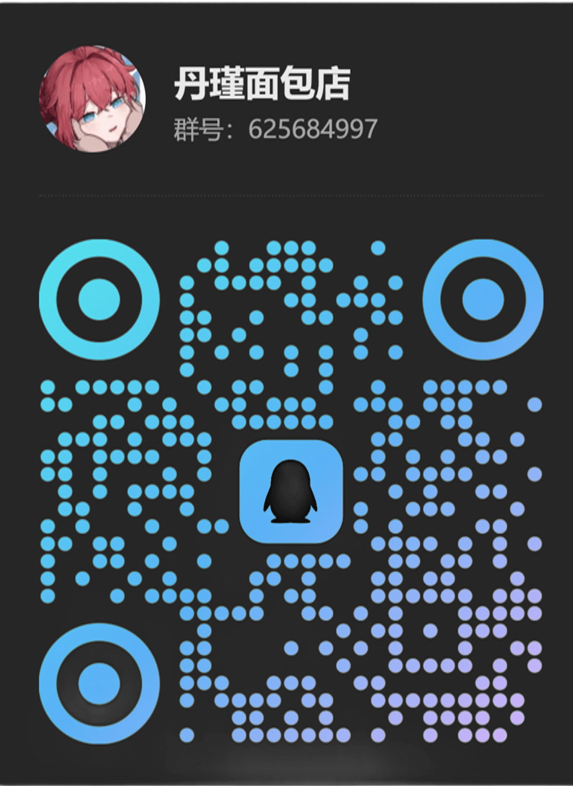
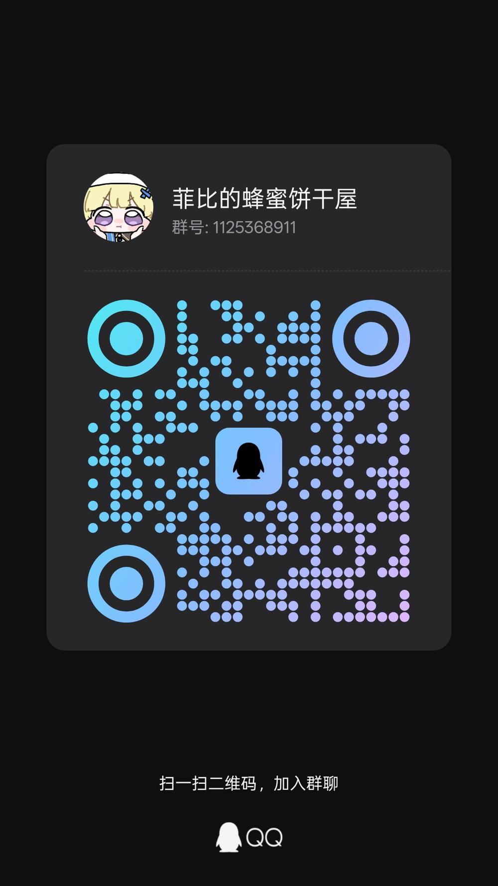

# 菲比使用指南

### 官 BOT 菲比

::: warning 平台迁移
腾讯官方正在大力推进官方机器人，并打击第三方协议端；原 NapCat 版菲比已被封。现在公开实例已切换为 **QQ 官方机器人（官机）**。
:::

#### 功能与收费

- 官 BOT 菲比保留原菲比约 **90%** 的功能
- 戳一戳等互动失效
- 依赖绑定 QQ 号的功能需要重新绑定或做数据映射
- 收费不变，原未到期用户继续使用

#### 官方 BOT 的限制

1. **无法私聊**，只能在群聊里使用。
2. 只有 BOT 管理员所在的群才允许邀请。菲比挂在 QQ `3823972084` 下，邀请前需要先把该号拉进群，并给它管理员权限。
3. 只有群主授权后，菲比才能发送主动消息（主要影响 `ww` 功能）；不授权仍可通过 `@菲比` 使用。
4. 官方 BOT 使用独立的 `openid` 代替 QQ 号，同一用户跨群 `openid` 会变，且没有明确映射关系。此前依赖 QQ 号的功能（如好感度、金币）可能暂时失效。
5. 鸣潮功能只需重新登录，数据按特征码索引，仍然保留。

#### 如何邀请 / 开通

1. 把 QQ `3823972084` 拉进目标群，并设为管理员。
2. 等待主人手动邀请官 BOT 菲比进群。
3. 官 BOT 进群后，`3823972084` 的管理员权限可以撤销。
4. 群主可按需进入 BOT 设置：
   - 不开启「获取群内全部消息」和「主动发言」也能用，但必须 `@菲比`。
   - 开启「机器人可获取的群聊消息范围 → 获取群内全部消息」和「机器人主动在群聊内发言」后，无需 `@`，和以前一样。
5. 完成后即可在群里 `@菲比` 使用。

#### 指令帮助

- `/帮助的帮助`：查看所有帮助（非常重要！）
- `ww帮助`：查看鸣潮插件帮助
- `/help`：查看所有命令帮助
- `/reset`：重置会话记录
- `/签到帮助`：查看签到与经济系统命令（签到、救济金等）
- `/好感度帮助`：获取好感度相关帮助
- `/设置昵称`：设置一个永久昵称，让菲比称呼你

#### 聊天

- LLM 聊天触发前缀：`菲比`（如果和其他指令冲突，请联系主人关闭）

#### 注意事项

- 吞消息通常是因为重启、触发模型请求上限，或官方 BOT 的回复窗口限制；请耐心等待
- AI 聊天禁止瑟瑟（有阿瓦隆系统，会被自动拉黑或退群处理）

#### 支持菲比

- `/投喂`：投喂菲比（这是最好的鼓励啦！）

### 常用地址

| 名称 | 地址 |
| :--- | :--- |
| 插件文档 | <https://docs.lsgbin.com> |

## 加入 & 支持

想体验菲比、了解最新动态，或让菲比进群，都可以加入我们的 QQ 群聊：

  <figure style="text-align: center; margin: 0; width: 250px;">
    
    <figcaption>加入我的个人 QQ 群</figcaption>
  </figure>

  <figure style="text-align: center; margin: 0; width: 250px;">
    
    <figcaption>菲比的蜂蜜饼干屋（群号 1125368911）</figcaption>
  </figure>

  <figure style="text-align: center; margin: 0; width: 250px;">
    
    <figcaption>微信赞赏码</figcaption>
  </figure>

